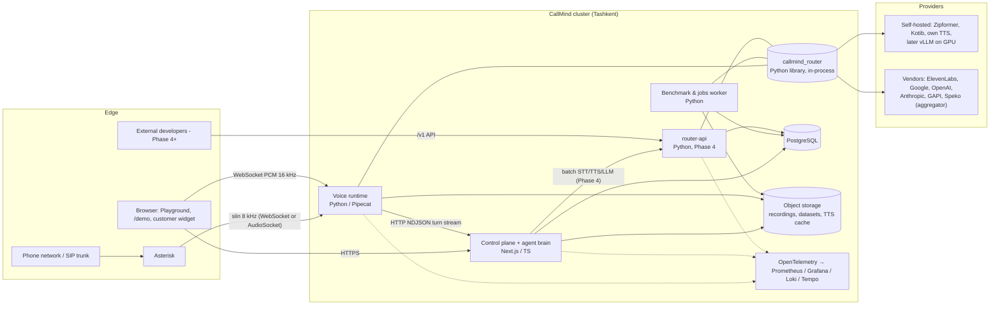
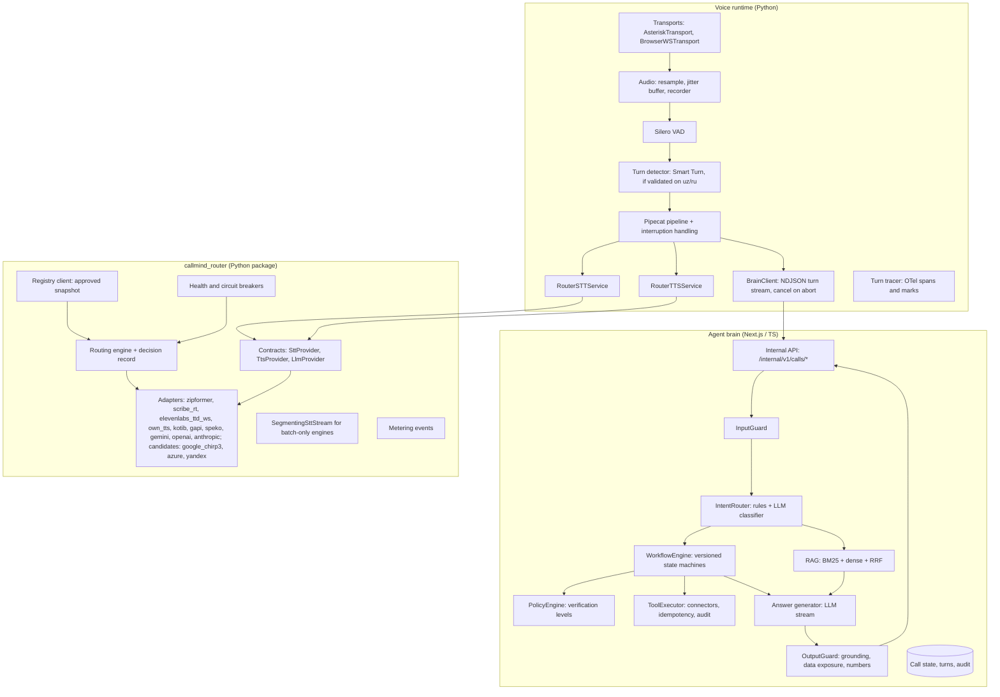
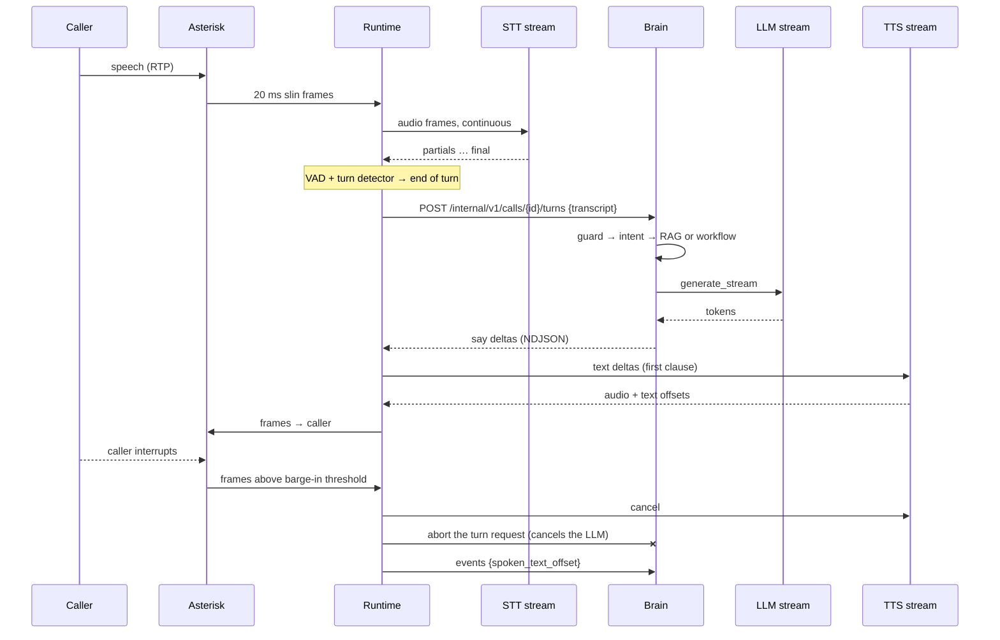
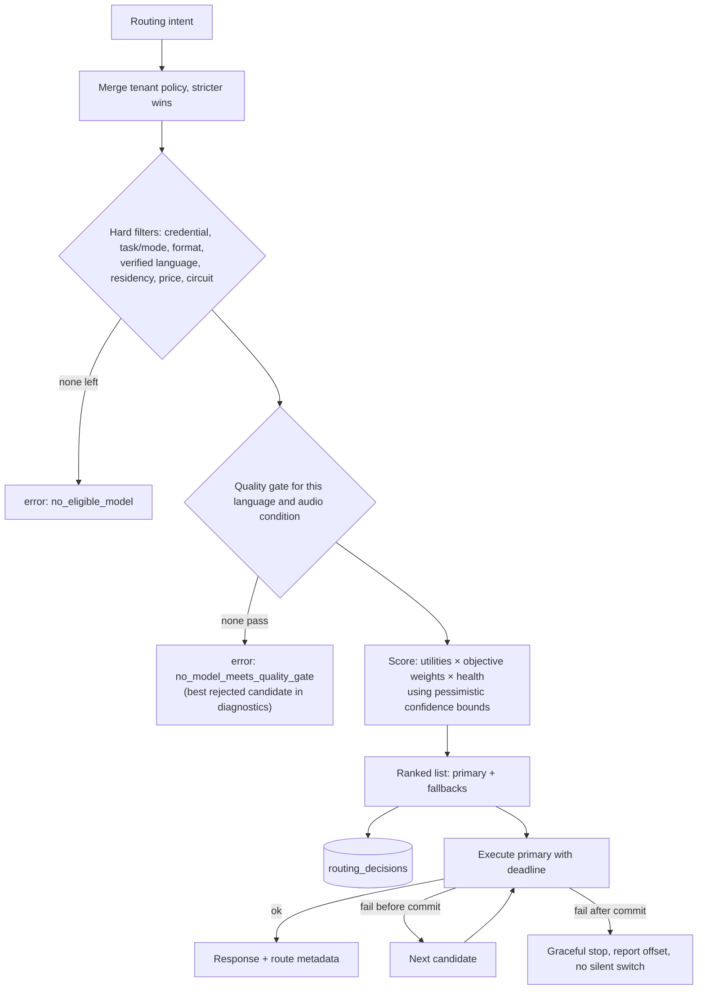
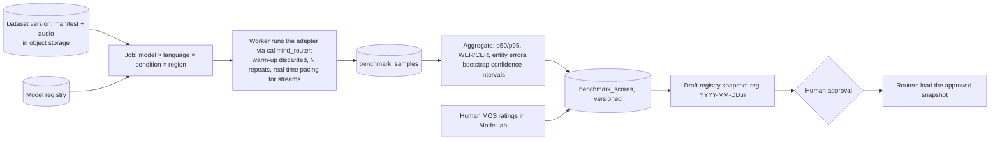
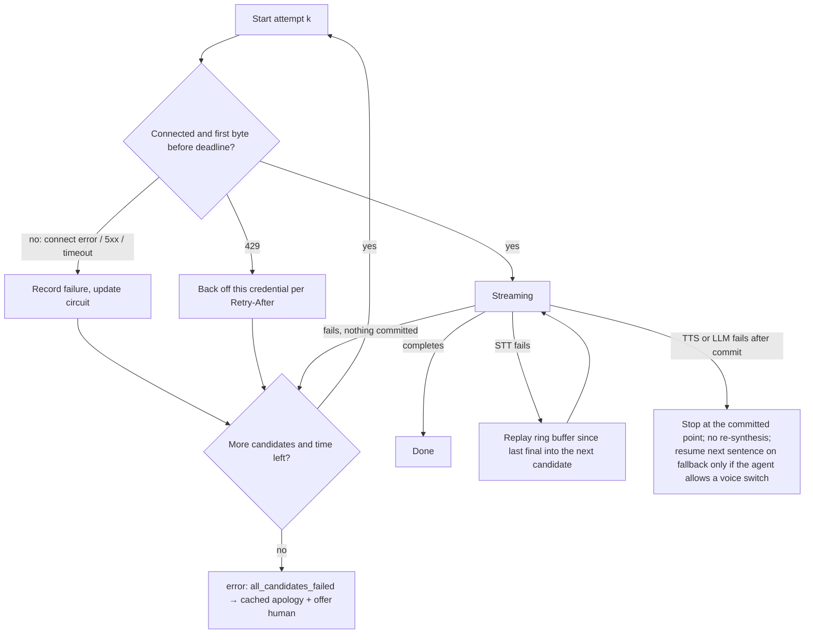

# CallMind Platform Architecture & Roadmap

**Status:** proposal for team review · **Date:** 2026-11-12 · **Basis:** the repository at `develop` (`40d6955`), the earlier latency investigation, and vendor documentation (see Sources).

**Labels used throughout:**
- **EXISTS**: verified in the repo.
- **NEW**: not in the repo; new work.
- **REFACTOR**: exists but must change.
- **VERIFY**: a third-party claim still to be confirmed against official docs or by our own measurement.

**How this is executed:** in small steps, each tested in the app before the next. Step 1 is real Playground latency numbers, streaming Gemini/Claude answers, and earlier first audio. See section J for the full roadmap.

---

## A. Executive summary

### What CallMind becomes
One foundation, four product areas, listed in the order they have to become real:

| Area | What it is | First customer |
|---|---|---|
| **CallMind Runtime** | Real-time voice for phone (Asterisk) and browser: streaming audio, VAD, turn detection, barge-in, STT/LLM/TTS overlap | our own agents |
| **CallMind Evaluation** | Language-specific benchmarks (uz-Latn, uz-Cyrl, ru, en), 8 kHz and noisy telephone conditions, simulated callers, call scoring | the Router and our own agents |
| **CallMind Agents** | Agent builder, RAG, deterministic workflows, banking tools, guards, human handoff, versions and rollback | the bank |
| **CallMind Router** | One API for STT/TTS/LLM with language-aware, evidence-based routing, fallback, managed keys and BYOK | ourselves first, external developers later |

- **The Router is the long-term differentiator.**
- **Evaluation is what makes the Router credible:** a router is only as good as its Uzbek and Russian evidence.
- **The Runtime is what fixes today's latency.**
- **The bank is the first serious workload,** and it forces the security and workflow work.

### Build first (next 90 days)
1. **Measure the truth:** end-to-end turn traces, benchmark v2, datasets v1, and a baseline report. Today's 2.5–6 s figure is an estimate; nothing measures a full turn.
2. **Cheap streaming fixes in the current app** that survive the migration: LLM streaming for Gemini and Claude, no header-blocked phone reply, cancellation, summary off the critical path. Also the **internal brain contract** the new runtime will call.
3. **Router contracts and the first 6 adapters, built as the speech layer of a Python/Pipecat runtime.** Then a runtime pilot on one agent, phone and browser, behind a flag.
4. **Security baseline** (B.3 items S1–S7) and **agent versioning.**
5. **Bank pilot in knowledge-only mode:** grounded RAG answers plus a real SIP transfer to a human.

### Postpone
- The public Router API, BYOK and router billing, until 2+ design partners ask.
- SDKs beyond Python/Pipecat.
- LiveKit and WebRTC.
- A visual workflow editor.
- GPUs, until the Phase 7 gate passes.
- Banking **write** actions, until workflows, verification, idempotency and audit pass a security review.

### Most important decisions
1. **Next.js/TypeScript stays the control plane and the agent brain.** A turn's time goes to waiting on providers, not CPU. 42k lines of working business logic would buy nothing by being rewritten.
2. **Python + Pipecat for the runtime.** Chosen for its turn-taking, interruption and audio ecosystem (Silero, Smart Turn, sherpa-onnx, vendor streaming SDKs), not because Python is faster. It isn't.
3. **The router starts as an in-process Python library** (`callmind_router`) shared by the runtime and the benchmark worker. It becomes a deployed service only when something outside the runtime needs it. No extra network hop on live audio, no premature microservice.
4. **Routing is evidence-based:**
   - Quality is a **hard gate** per language and audio condition; latency and cost are **scored** against fixed reference points, using pessimistic confidence bounds and per-region latency.
   - A live call **routes once and keeps its route**.
   - **Fallback only before output is committed** to the caller.
5. **SQLite → PostgreSQL and local disk → S3-compatible object storage** before a second service writes data, or the control plane needs a second replica.
6. **Banking actions run only through deterministic workflows** with backend authorisation, explicit confirmation, idempotency keys and an append-only audit log. The LLM proposes; code decides; the bank's API authorises.

**Honest status:**
- The latency targets (p50 ≤ 800 ms, p95 ≤ 1.3 s mouth-to-ear) are **hypotheses until Phase 1 measures the baseline.**
- No cloud vendor's Uzbek streaming accuracy is proven until our 8 kHz Uzbek set says so.

### What Speko actually does (from its official docs) and where CallMind differs

| Speko (documented) | What we take from it | Where CallMind differs |
|---|---|---|
| A hosted **Router** for STT/LLM/TTS (`router.speko.dev`) with `routing.mode: auto \| explicit`, objectives `balanced \| quality \| latency \| cost`, allow/deny provider lists | The same intent shape: objective + constraints + pin | Quality is a **gate** per language and audio condition, not one objective among four |
| **Fallback only in auto mode and only before the first output byte**; never crosses between BYOK and managed keys | The same commit rule (G.6), which confirms it's the right default | We add STT replay from a ring buffer (STT is safe to replay) |
| STT and TTS **WebSockets** (`/v1/stt/stream`, `/v1/tts/stream`) with barge-in `input.cancel`; AsyncAPI contract | A streaming-first API with a formal contract | Our own message names (E.2/E.4); `text_offset` on audio for exact barge-in truncation |
| An open-source, self-hosted **Gateway** (provider keys stay local; BYOK traffic goes provider-direct); **Pipecat and LiveKit plugins**; SDKs | Library + plugins + gateway is the right product shape (our Phase 5) | We start with the library inside our own runtime and earn the gateway later |
| Per-language quality boards cover **18 languages; Uzbek and Russian are not among them**; audio formats are `pcm_s16le`/`opus` only (no μ-law) | — | **Our opening:** verified uz-Latn/uz-Cyrl/ru evidence on 8 kHz telephone audio, in-country hosting and residency modes. Compete on regional depth, not on breadth of providers. |

---

## B. Current architecture assessment

### B.1 What exists (verified in the repo)

| Area | Implementation | Notes |
|---|---|---|
| App | One Next.js 16 / TS app, ~42k lines, 21 API routes, 3–4 regular contributors | UI, public API, all voice routes |
| Data | `node:sqlite` (synchronous) at `data/ovoz.db`, WAL; 26 tables with in-code migrations (`src/lib/db.ts`); uploads, voice samples and TTS cache on local disk under `data/` | Migrations run inside the web process |
| Process-local state | Event bus (`globalThis.__ovozBus`, `src/lib/engine/bus.ts`), SSE at `/api/stream`, call locks, prefetched transcripts, Zipformer sessions, simulator timers, demo rate limiter | **⇒ effectively one replica** |
| Tenancy and auth | Tenants, users (owner/admin/operator/analyst), DB sessions with HMAC cookies, scrypt passwords | No MFA, reset, SSO or throttling |
| Public API | `POST /api/v1/answer`, `GET /api/v1/calls`, `POST /api/v1/documents`; keys `ovoz_sk_…`, SHA-256 hash, scopes `read`/`write` | No rate limits, expiry or quotas |
| Webhooks | HMAC-signed, fire-and-forget, no retries | Secret stored in plaintext |
| Phone | `telephony-bridge/bridge.mjs`: Asterisk **AudioSocket** over TCP, slin 8 kHz, 20 ms frames, energy VAD (350 ms), barge-in, fillers | **No SIP transfer** (plays the line and hangs up); DTMF ignored; one static number per bridge |
| STT | Kotib (own, batch), Whisper (batch), GAPI (batch), **Zipformer** (in-process sherpa-onnx, streaming via 250 ms HTTP polls), gemini-3.5 and ElevenLabs Scribe (via Speko, batch), Gemini Flash-Lite (batch) | Metadata in a static TS list (`src/lib/speech/registry.ts`) |
| TTS | Own TTS server (`generate_v2/stream`, HTTP chunked, 8 kHz), ElevenLabs v3 and v4 Turbo (via Speko, HTTP chunked) | Disk cache for fixed lines |
| LLM | OpenAI (streams), Ollama (streams only with `onDelta`), **Gemini and Claude not streamed**, local extractive fallback (`synthesizeLocal`) | **No tool calling in any provider**; no fallback to a second hosted model |
| RAG | Hybrid BM25 + dense + RRF; local 384-dim hashed embeddings, or OpenAI embeddings when `OPENAI_API_KEY` is set; vectors as BLOBs in SQLite, scanned in memory | Per tenant, not per agent; embedding fetch has no timeout |
| Brain | `runTurn` (`src/lib/engine/conversation.ts`): retrieval → generation → escalation → persistence (no transaction) → gaps → **summary awaited inside the turn** → webhook → bus | The TTS time in traces is a formula (`:288`) |
| Intent | 16 generic regex intents (`src/lib/llm/local.ts:21-61`); none are banking intents | The model returns no intent |
| Guard | **Not present anywhere in this repository** (all branches searched) | Must be brought in or built (NEW) |
| Banking | Outbound loan-reminder only: a prompt plus a year-of-birth check recomputed from the transcript each turn (`src/lib/llm/loan-call.ts`); bypassed if no year on file (`provider.ts:124`) | No CRM or core-banking integration |
| Agent config | `agents.version` integer bumped on save; edits go live immediately | No history, publish step or rollback; `tools_json`, `temperature`, `fallback_line` stored but unused |
| Benchmarks | Once per build, inside the web process; means over 3–10 samples; no raw samples; TTS "first audio" measured after a 0.25 s holdback (`src/lib/benchmark.ts`) | `lab_clips`/`lab_runs` tables unused |
| Languages | Voice path `Locale = 'en' \| 'ru' \| 'uz'` | Uzbek Cyrillic only in UI strings |
| Ops | Docker (bookworm), GitLab CI: `tsc` + `npm audit` + build + isolated smoke | No unit tests, health endpoint, metrics or tracing |

### B.2 Limitations, ranked by how much they block the vision
1. **Latency (phone):**
   - Batch STT, with Kotib and Whisper raced but both awaited (`stt.ts:486`).
   - No LLM streaming on the phone route.
   - The **reply text in the `x-ovoz-text` header** forces the whole LLM answer before any audio.
   - TTS renders sentences sequentially.
   - The escalation summary is on the critical path.
   - Estimated 2.5–6 s per turn; **never measured end to end.**
2. **Single-replica design:** SQLite on local disk, an in-memory bus and in-memory call state. Blocks HA, horizontal scaling and any second service writing data.
3. **No banking action capability:** no guards, banking intents, tools, workflows, OTP/DTMF verification, idempotency, action audit or SIP transfer.
4. **Benchmarks can't drive routing:** means instead of percentiles; no raw samples; no 8 kHz, noise, code-switching, Cyrillic or banking datasets; no versioning; they run in the web process.
5. **Hard-wired providers:** a separate call path and error style per engine; a static registry; no normalised errors, health or circuit breakers; keys only in env vars.
6. **Duplicated voice code:** `speakAsWritten`, `eventStream`, fillers and call locks are copied in `demo.ts` and `playground-voice.ts`; prefetch exists three times; greeting/seed logic three times. Each route decides on its own what an escalation means.
7. **No agent versioning:** a prompt edit is an unreviewed production change. Unacceptable for a bank.
8. **Strategic dependency:** the main cloud voices and Scribe are reached only through Speko, the platform CallMind wants to compete with.

### B.3 Security and production-readiness gaps (fix before any bank go-live)

| # | Gap | Evidence | Severity |
|---|---|---|---|
| S1 | Landing page claims "AES-256 for stored transcripts", but **nothing is encrypted at rest** | `i18n-landing.ts:181-182` | **Critical** (misleading claim) |
| S2 | Migration `009_single_admin` hard-codes an owner password hash and **deletes all other users and sessions** on any database it runs on | `db.ts:468-485` | **Critical** for multi-tenant |
| S3 | Tenant isolation is a hand-written `WHERE tenant_id=?` per query; the promised `tenancy.ts` doesn't exist; one session delete lacks a tenant filter | `db.ts:8-9`, `ops.ts:310` | High |
| S4 | `phone_numbers.e164` isn't unique across tenants; inbound routing takes the first match | `db.ts:135-148`, `telephony/bridge.ts:38-41` | High |
| S5 | SSRF: knowledge-base URL import and webhook URLs may target internal addresses | `knowledge.ts:80-88`, `ops.ts:358-363` | High |
| S6 | Webhook secrets in plaintext, sent to the client for every role | `db.ts:239`, `developers/page.tsx:17-20` | High |
| S7 | Open signup; no login throttling, MFA, password reset or email verification; 30-day sessions without rotation | `actions/auth.ts`, `auth.ts:16,107-115` | High |
| S8 | API keys never expire; scopes unvalidated; no rate limits on `/api/v1/*`, `/api/speech/*`, `/api/playground/*` | `api-auth.ts`, `ops.ts:318-331` | Medium |
| S9 | No health/readiness endpoints, metrics or tracing; CI only probes `/` | `ci-isolated-smoke.sh:19` | Medium |
| S10 | Call audio never recorded (`calls.recording_url` never written); retention only on `model_usage` | `db.ts:177`, `usage-log.ts:49` | Medium (banks need recordings) |
| S11 | STT and LLM usage rows lack `tenant_id`; billing is a fixed rate card; the wallet can go negative | `stt.ts:181`, `provider.ts:488-499`, `calls.ts:139,249` | Medium |
| S12 | Admins can assign any role, including `owner`; any role can create voice clones (no consent record) | `ops.ts:283-314`, `actions/voices.ts:88-139` | Medium |
| S13 | ~~Twilio signature checked without the query string~~ — moot: the Twilio route was removed on 17 Nov 2026 | — | — |

### B.4 Reuse as-is
- RAG and ingestion; knowledge gaps.
- Number normalisation (`src/lib/speech/numbers.ts`, `normalize.ts`), WER/CER scoring (`src/lib/speech/scoring.ts`), `percentile` (`src/lib/utils.ts`).
- TTS disk cache; usage log (`model_usage`).
- Auth, sessions, roles; API keys (hashed, scoped); webhooks; `audit_log`; billing tables.
- Model lab UI shell.
- Bridge VAD and barge-in behaviour as the **reference** for the new runtime's acceptance tests.

---

## C. Target architecture

### C.1 High level



### C.2 Component detail



### C.3 Phone call data flow



### C.4 Browser call data flow
- The browser opens `wss://…/voice/ws?token=…`. The token is a short-lived JWT minted by the control plane after login, carrying `tenant_id`, `agent_id`, `call_id` and the origin.
- 16 kHz PCM goes up; PCM comes down; JSON control frames carry transcript and state.
- After the transport, the flow is identical to C.3. **One runtime replaces four separate code paths** (playground, demo, logistics, phone bridge).
- WebRTC is a later transport option (Pipecat `SmallWebRTCTransport`), only if measurements show WebSocket/TCP jitter matters on real mobile networks.

### C.5 Model routing flow



### C.6 Benchmarking flow



### C.7 Provider failover flow



### C.8 Banking tool execution flow

```mermaid
sequenceDiagram
  participant R as Runtime
  participant B as Brain (IntentRouter + WorkflowEngine)
  participant P as PolicyEngine
  participant K as Bank API connector
  participant AU as Audit log
  R->>B: "kartamni bloklang"
  B->>B: rules → intent=card_block (0.98)
  B->>P: allowed at the current verification level (L0)?
  P-->>B: requires L2
  B->>K: send_otp(customer_ref) [Idempotency-Key]
  B-->>R: say "Tasdiqlash uchun SMS kod yubordim…"
  R->>B: "4 7 1 9" (digits or DTMF; turn marked sensitive)
  B->>K: verify_otp → ok → level L2
  B-->>R: say "Oxiri 1234 bo'lgan kartani bloklaymi?"
  R->>B: "ha"
  B->>AU: action.requested
  B->>K: block_card(card_ref) [Idempotency-Key]
  K-->>B: blocked
  B->>AU: action.succeeded
  B-->>R: say "Karta bloklandi."
```

---

## D. Component specifications

### D.1 Control plane: Next.js / TypeScript (EXISTS → REFACTOR)
- **Responsibility:**
  - Tenants, users, roles, sessions, API keys; provider credentials (NEW).
  - Agents and agent versions (NEW).
  - Knowledge base; calls and turns; analytics; billing.
  - Model catalog UI and benchmark administration; registry snapshot approval (NEW).
- **Why TypeScript:** it is where all business rules already live. The work is I/O-bound. The team knows it.
- **Interfaces:**
  - UI: React Server Components and Server Actions.
  - Public `/api/v1/*` (exists).
  - Internal `/internal/v1/*` (NEW, E.10).
  - Calls `router-api` in Phase 4.
- **Depends on:** Postgres (after migration), object storage, LLM providers (directly until Phase 4), bank connectors.
- **Failures:** if it is down, the runtime plays a cached fallback line and transfers; dashboards are unavailable.
- **Scaling:** stateless after Postgres, 2+ replicas. The bus moves to Postgres `LISTEN/NOTIFY`; simulator timers move to the worker. **Today: 1 replica.**
- **Implementation note:** per `AGENTS.md`, read `node_modules/next/dist/docs/` (route handlers, streaming, instrumentation) before changing routes.

### D.2 Agent brain: TypeScript, inside the control plane deployment (EXISTS `runTurn` → REFACTOR)
- **Responsibility:**
  - Context assembly and conversation history.
  - InputGuard → IntentRouter → PolicyEngine → WorkflowEngine / RAG → answer generation → OutputGuard.
  - Escalation and handoff decisions.
  - Persistence of turns, workflow state and audit.
- **Separate module, same deployment** as the control plane. It shares the DB and code, and an extra service would add a hop for nothing. It can be split later if load or isolation demands it.
- **Interfaces:** `/internal/v1/calls`, `/turns` (NDJSON stream), `/events`, `/end` (E.10). Every route that runs a turn today (demo, playground, logistics, bridge) becomes a client of the same brain API, so one escalation semantic replaces four.
- **Refactor steps:**
  - Split `runTurn` into ports: `Retriever`, `AnswerGenerator` (streaming), `EscalationPolicy`, `TurnStore` (transactional), `Notifier`.
  - Move the summary out of the turn.
  - Remove the TTS-time formula.
  - Move loan-specific branches out of the generic escalation code into a `loan_reminder` workflow.
- **Failures:**
  - LLM failure → G.6 semantics, then a cached apology.
  - Tool failure → the workflow's error state (retry with the same idempotency key, or a handoff).
- **Scaling:** with the control plane. LLM calls are I/O-bound.

### D.3 Voice runtime: Python / Pipecat (NEW)
- **Responsibility:** transports, audio conditioning, VAD, turn detection, barge-in and cancellation, streaming STT/TTS through `callmind_router`, the brain client, fillers and cached prompts, call recording to object storage (consented tenants), timing traces.
- **Owns no business logic, agent config or database.** It fetches a runtime config at call start.
- **Why Python:** Pipecat's pipeline and interruption model, Silero and Smart Turn integration, sherpa-onnx streaming bindings, and vendor streaming SDKs. Node is equally capable at sockets; the ecosystem is the reason.
- **Interfaces:**
  - In: the Asterisk link and browser WS. Out: HTTP NDJSON to the brain; provider WS/HTTP through the library.
- **Asterisk link: two options, decided in the Phase 3 spike.**
  - **(a) Asterisk WebSocket channel (`chan_websocket`)** with the community `pipecat-asterisk` serializer.
    - Requires Asterisk ≥ 20.16 / 21.11 / 22.6 / 23.0; JSON control messages from 20.18 / 22.8 / 23.2.
    - The serializer is **not officially supported by Pipecat** and lists slin rates from 12 kHz up, so we'd ask Asterisk for `slin16` (narrowband audio upsampled; no quality gain).
  - **(b) A custom AudioSocket transport.**
    - AudioSocket since Asterisk 18; 8 kHz slin, with higher rates since 20.17.
    - Our protocol code already exists in `bridge.mjs`; about 200 lines to port.
  - **Default:** (b) if the deployed Asterisk is older or the serializer misbehaves; (a) otherwise.
- **Failures:**
  - A pod crash drops its calls. Mitigate with a per-pod call cap, a `preStop` drain (stop accepting, finish active calls) and Asterisk routing to healthy pods.
  - The brain is unreachable → cached apology plus transfer.
- **Scaling:** horizontal on active calls. Each call is pinned to one pod with no shared state, so **no Redis**. Per-call CPU and memory are measured in the Phase 3 spike before sizing.

### D.4 `callmind_router`: library (NEW, Phase 3) and `router-api` service (NEW, Phase 4)
- **Responsibility:** provider adapters (F), registry snapshot client, routing engine (G), deadlines, health and circuit breakers, failover, metering events, normalised errors.
- **Library mode:** imported by the runtime and the worker; zero extra hops.
- **Service mode:**
  - FastAPI + uvicorn, stateless, 2+ replicas.
  - Serves `/v1/*` (E) for developers and the control plane's batch needs: Model lab, TTS for greetings and fillers, `/api/v1/answer`.
  - Health state shared through Postgres (5 s refresh). Redis only if measured contention justifies it.
- **Failures:** if `router-api` is down, the control plane's batch features degrade. Live calls are unaffected, because the runtime embeds the library.
- **Scaling:** CPU-light. Streaming proxy connections are the main load, sized at ~2 KB/s per audio stream.

### D.5 Benchmark & jobs worker: Python (NEW)
- **Responsibility:**
  - Benchmark jobs (C.6); network probes every 5 minutes; dataset preparation (8 kHz μ-law, noise mixing); aggregation.
  - Nightly live conformance runs; recording post-processing; retention deletions.
  - Later: the simulator and webhook retries.
- **One deployment, with a job queue in Postgres** (`FOR UPDATE SKIP LOCKED`). No broker.
- **Why separate:** paid benchmark calls and CPU-heavy work must not compete with live calls or the UI. Today the benchmark runs inside the Next.js process.

### D.6 Data stores
- **PostgreSQL (NEW, replaces SQLite in Phase 4a):** first needed when the worker or `router-api` writes, or the control plane needs 2+ replicas. Use `pgvector` when the knowledge base outgrows the in-memory scan.
- **S3-compatible object storage, in-country, e.g. MinIO (NEW):** recordings, datasets, TTS cache, uploads, benchmark audio.
- **Redis:** not planned. Add it only for a measured need, e.g. cross-replica rate limiting.

### D.7 Evaluation system: metric definitions (NEW, in the worker plus the Model lab)

| Task | Metric | Definition / method |
|---|---|---|
| STT | WER / CER | After normalisation (Latin↔Cyrillic, ‘ ’ ʻ ' variants, digit grouping), reusing `src/lib/speech/scoring.ts` |
| STT | Banking-term accuracy | Recall of a curated term list (product names, "kredit", "foiz stavkasi", card brands such as Humo and UzCard) present in references |
| STT | Names and numbers | Entity error rate: exact match of digit strings (card endings, amounts, dates) and names |
| STT | Code-switching | WER split by segment language on the code-switch set |
| STT | Time to first partial | First audio frame sent → first partial received, real-time paced |
| STT | Finalisation latency | End of speech in the audio timeline → final transcript received |
| STT | Telephone and noise robustness | Same metrics on 8 kHz G.711 μ-law round trip, and with noise mixed at 20/10/5 dB SNR |
| TTS | Time to first byte | Request sent → first audio byte, **before** any holdback, per region |
| TTS | Real-time factor | Synthesis time ÷ audio duration |
| TTS | Streaming smoothness | Underruns: playback gaps when chunk arrival lags real time |
| TTS | Pronunciation | ASR round-trip CER with 2 different STT engines, plus a targeted set (numbers, names, terms) |
| TTS | Naturalness | MOS 1–5 from 5 native raters per language per voice |
| TTS | Long-response stability | 60 s replies: artefacts, rate drift, truncation |
| LLM | Time to first token / first speakable clause | First clause = first `,` `.` `?` `!` boundary after ≥ 4 words |
| LLM | Instruction following, uz/ru quality | Rubric; LLM judge + weekly human sample; the judge is never the model being judged |
| LLM | Hallucination | Claims unsupported by the retrieved excerpts (judge + human sample) |
| LLM | Intent and tool reliability | Accuracy and slot F1 on a labelled banking intent set |
| LLM | Context handling | Scripted multi-turn tests (references to earlier turns) |
| E2E | Mouth-to-ear p50/p95 | Simulator: end of caller speech → first non-silent agent audio |
| E2E | False interruption rate | The agent speaks during a natural mid-sentence pause (needs clips with pauses) |
| E2E | Barge-in response | Caller speech onset → agent audio stops |
| E2E | Completion, escalation and task success | Scripted simulated callers with goals; deterministic checks (workflow reached state X) + judge |

**Dataset v1 (NEW):**
- uz-Latn ≥ 1 h (≥ 600 utterances, ≥ 30 speakers, regional accents).
- uz-Cyrl text set (normalisation plus TTS input).
- ru ≥ 30 min; en ≥ 15 min.
- Banking terms ≥ 200 utterances; names and numbers ≥ 200; code-switching ≥ 150.
- Every audio item in 16 kHz clean, 8 kHz μ-law, and noisy variants.
- Licences and consent recorded per item; frozen and versioned.
- The existing `benchmarks/stt-uz` (10 read clips) becomes the smoke set.

**The "claimed → verified" rule:** a vendor's language list only creates a `claimed` entry. A language becomes `verified` for routing only after a benchmark run on our dataset with ≥ 200 samples passes the quality gate.

---

## E. API contracts

There are two families:
- **Public Router API** `/v1/*` (NEW, Phase 4).
- **Internal contracts** (NEW, Phase 2–3).

Every response carries a `request_id`, and a `route` object whenever a model was selected. Errors use one envelope: `{"error": {"code": "...", "message": "...", "retryable": bool, "attempts": [...]}}`.

### E.1 STT (batch)
`POST /v1/stt/transcriptions` (multipart: a `request` JSON part, then an `audio` part)

```json
{
  "language": "uz-Latn",
  "audio": { "encoding": "pcm_s16le", "sample_rate_hz": 8000, "channels": 1 },
  "routing": { "objective": "accuracy", "constraints": { "data_residency": "any" } },
  "options": { "word_timestamps": true, "numbers_as_digits": true, "vocabulary": ["Humo", "UzCard"] }
}
```

```json
{
  "request_id": "req_01HZX3K9",
  "text": "Kartamni bloklamoqchiman, oxiri 1234",
  "language": "uz-Latn",
  "words": [{ "w": "Kartamni", "start_ms": 120, "end_ms": 610, "conf": 0.97 }],
  "route": {
    "provider": "elevenlabs", "model": "scribe_v2", "decision_id": "dec_9k2",
    "snapshot": "reg-2026-11-12.3", "objective": "accuracy", "pinned": false,
    "fallbacks_considered": ["gapi:default", "local:zipformer-uz-8k"]
  },
  "timing": { "queued_ms": 2, "provider_ms": 1840, "total_ms": 1851 },
  "usage": { "audio_seconds": 3.4, "cost_usd": 0.00037, "credential": "managed" },
  "attempts": [{ "provider": "elevenlabs", "model": "scribe_v2", "outcome": "ok", "ms": 1840 }]
}
```

### E.2 Streaming STT
`GET /v1/stt/stream` (WebSocket).

Client → server: a `session.start` message, then **binary frames** of 20–100 ms audio, an optional `{"type":"input.commit"}`, and `{"type":"session.end"}`.

```json
{ "type": "session.start", "language": "uz-Latn",
  "audio": { "encoding": "pcm_s16le", "sample_rate_hz": 8000 },
  "routing": { "objective": "latency" }, "options": { "interim_results": true } }
```

Server → client:

```json
{ "type": "session.started", "request_id": "req_…", "route": { "provider": "local", "model": "zipformer-uz-8k", "decision_id": "dec_…" } }
{ "type": "transcript.partial", "text": "kartamni blok", "stable_chars": 8, "audio_ms": 1180 }
{ "type": "transcript.final", "text": "Kartamni bloklamoqchiman.", "start_ms": 0, "end_ms": 1720, "latency_ms": 190 }
{ "type": "route.switched", "from": "elevenlabs:scribe_v2_realtime", "to": "local:zipformer-uz-8k", "reason": "stream_failure", "replayed_ms": 940 }
{ "type": "error", "code": "all_candidates_failed", "retryable": false }
{ "type": "session.ended", "usage": { "audio_seconds": 61.2, "cost_usd": 0.0 } }
```

### E.3 TTS (batch)
`POST /v1/tts/speech` returns `200` with streamed audio (`audio/L16;rate=8000`).
- Route metadata in headers: `X-Request-Id`, `X-Route-Provider`, `X-Route-Model`, `X-Route-Decision`, `X-Route-Snapshot`.
- Usage in an HTTP trailer and at `GET /v1/requests/{id}`.

```json
{ "text": "Kartangiz bloklandi.", "language": "uz-Latn", "voice": "cm_voice_dilnoza",
  "audio": { "encoding": "pcm_s16le", "sample_rate_hz": 8000 }, "routing": { "objective": "latency" } }
```

`voice` is a **CallMind voice id**, bound to provider voices in the registry. Routing only considers providers that carry that voice.

### E.4 Streaming TTS
`GET /v1/tts/stream` (WebSocket). Client:

```json
{ "type": "session.start", "voice": "cm_voice_dilnoza", "language": "uz-Latn",
  "audio": { "encoding": "pcm_s16le", "sample_rate_hz": 8000 }, "routing": { "objective": "latency" } }
{ "type": "text.delta", "text": "Assalomu alaykum, " }
{ "type": "text.delta", "text": "kartangiz bloklandi." }
{ "type": "text.flush" }
{ "type": "cancel" }
```

Server: binary audio frames, interleaved with JSON metadata.

```json
{ "type": "audio.meta", "seq": 7, "text_offset": [18, 38], "duration_ms": 320 }
{ "type": "synthesis.done", "seq_last": 12, "usage": { "chars": 38, "cost_usd": 0.0014 } }
```

`text_offset` tells the runtime exactly what was spoken when the caller barges in.

### E.5 LLM
`POST /v1/llm/chat/completions`: OpenAI-compatible, plus a `routing` field.
- With `stream: true`: SSE `chat.completion.chunk` events.
- The final event adds `route`, `usage` and `attempts`.
- Compatible on purpose, so existing SDKs work unchanged.

### E.6 Model discovery
`GET /v1/models?task=stt&language=uz-Latn&mode=stream`

```json
{ "snapshot": "reg-2026-11-12.3",
  "models": [{
    "id": "local:zipformer-uz-8k", "task": "stt", "modes": ["stream", "batch"],
    "languages": { "uz-Latn": "verified", "uz-Cyrl": "claimed" },
    "evidence": { "uz-Latn": { "dataset": "cm-uz-tel-v1", "wer": 0.142, "wer_ci90": [0.128, 0.157],
                               "final_latency_p95_ms": 210, "samples": 640, "region": "uz-tashkent" } },
    "price_per_min_usd": 0, "hosting": "self_hosted", "health": "ok" }] }
```

(Numbers are illustrative, not measurements.)

### E.7 Automatic and manual routing
- `POST /v1/routing/preview` takes a routing intent (G.1) and returns:
  - the ranked candidates with per-metric utilities;
  - the filtered-out candidates with reason codes (`language_unverified`, `residency`, `circuit_open`, …);
  - the decision record.
  - It calls no provider.
- **Automatic:** the request carries `routing.objective`.
- **Manual:** add `"pin": {"provider": "elevenlabs", "model": "eleven_v4_turbo", "fallback": false}`. The pin skips ranking, **not** the hard filters.

### E.8 Health checks
- `GET /v1/health` (liveness) and `GET /v1/ready` (DB, registry snapshot loaded).
- `GET /v1/providers/health?region=uz-tashkent`:

```json
{ "region": "uz-tashkent", "as_of": "2026-11-12T10:15:00Z",
  "providers": [{ "model": "elevenlabs:eleven_v4_turbo", "state": "closed",
                  "success_rate_5m": 0.995, "p95_first_byte_ms_5m": 410, "rate_limited": false }] }
```

### E.9 Usage
`GET /v1/usage?from=2026-11-01&to=2026-11-30&group_by=provider,model,language`

```json
{ "rows": [{ "provider": "elevenlabs", "model": "eleven_v4_turbo", "language": "uz-Latn",
             "requests": 18234, "failures": 41, "units": { "chars": 1203345 },
             "cost_usd": 45.62, "credential": "managed", "p95_latency_ms": 430 }] }
```

BYOK usage is reported but not re-billed.

### E.10 Internal: runtime ↔ brain (Phase 2–3)
**Start a call:** `POST /internal/v1/calls` →

```json
{ "call_id": "call_7f3a", "agent_version_id": "agv_12",
  "runtime": { "language": "uz-Latn", "voice": "cm_voice_dilnoza",
               "stt": { "objective": "latency", "pin": null }, "tts": { "objective": "latency", "pin": { "provider": "elevenlabs", "model": "eleven_v4_turbo" } },
               "greeting": "Assalomu alaykum, …", "barge_in": { "min_speech_ms": 240 },
               "fillers": { "after_ms": 700 }, "record": true } }
```

**Run a turn:** `POST /internal/v1/calls/{id}/turns`
- Request: `{"turn_id":"t5","transcript":"…","stt":{"engine":"…","final_latency_ms":190},"prev_turn":{"spoken_text_offset":42,"interrupted":true}}`
- Response stream (NDJSON):

```
{"t":"say","text":"Albatta, "}
{"t":"say","text":"kartangizni bloklash uchun…"}
{"t":"action","kind":"collect_digits","max":6,"sensitive":true}
{"t":"end","meta":{"intent":"card_block","workflow_state":"verify_otp"}}
```

- Aborting the HTTP request cancels generation: the brain observes `request.signal`.

**Other endpoints:** `POST /internal/v1/calls/{id}/events` (barge-in, offsets, timing marks) and `POST /internal/v1/calls/{id}/end`.

**Auth:** a per-service secret now, mTLS later, plus a NetworkPolicy so only the runtime may reach `/internal/*`.

---

## F. Provider architecture

### F.1 Contracts (Python, `callmind_router/contracts.py`, NEW)

```python
from typing import AsyncIterator, Literal, Protocol
from pydantic import BaseModel

AudioEncoding = Literal["pcm_s16le", "mulaw", "alaw", "opus", "wav", "mp3"]

class AudioFormat(BaseModel):
    encoding: AudioEncoding
    sample_rate_hz: int
    channels: int = 1

class Capabilities(BaseModel):
    task: Literal["stt", "tts", "llm", "s2s"]
    modes: set[Literal["batch", "stream"]]
    emulated_stream: bool = False                  # batch engine behind SegmentingSttStream
    languages: dict[str, Literal["claimed", "verified", "rejected"]]
    input_formats: list[AudioFormat] | None = None
    output_formats: list[AudioFormat] | None = None
    max_audio_seconds: int | None = None
    max_chars: int | None = None
    text_streaming_in: bool = False                # TTS accepts text deltas
    word_timestamps: bool = False
    regions: list[str] = []
    hosting: Literal["vendor_cloud", "aggregator", "self_hosted"]

class CallContext(BaseModel):
    request_id: str
    tenant_id: str
    credential: "ResolvedCredential"               # decrypted in memory only
    deadline_ms: int
    trace: "TraceContext"                          # adapters record connect/first_byte/last_byte

class SttProvider(Protocol):
    id: str
    def capabilities(self, model: str) -> Capabilities: ...
    async def health_check(self, model: str) -> "Health": ...
    async def transcribe(self, ctx: CallContext, model: str, audio: bytes, fmt: AudioFormat,
                         language: str | None, hints: "SttHints") -> "Transcript": ...
    def transcribe_stream(self, ctx: CallContext, model: str, fmt: AudioFormat,
                          language: str | None, hints: "SttHints") -> "SttStreamSession": ...

class SttStreamSession(Protocol):
    async def send_audio(self, chunk: bytes) -> None: ...
    async def commit(self) -> None: ...
    async def close(self) -> None: ...
    def events(self) -> AsyncIterator["SttEvent"]: ...   # Partial | Final | SpeechStarted | ProviderError

class TtsProvider(Protocol):
    id: str
    def capabilities(self, model: str) -> Capabilities: ...
    async def health_check(self, model: str) -> "Health": ...
    def synthesize(self, ctx: CallContext, model: str, voice: str, text: str,
                   fmt: AudioFormat, language: str) -> AsyncIterator["AudioChunk"]: ...
    def synthesize_stream(self, ctx: CallContext, model: str, voice: str,
                          fmt: AudioFormat, language: str) -> "TtsStreamSession": ...

class TtsStreamSession(Protocol):
    async def send_text(self, delta: str) -> None: ...
    async def flush(self) -> None: ...
    async def cancel(self) -> None: ...                  # must stop audio within 100 ms
    def audio(self) -> AsyncIterator["AudioChunk"]: ...   # carries seq + text_offset

class LlmProvider(Protocol):
    id: str
    def capabilities(self, model: str) -> Capabilities: ...
    async def health_check(self, model: str) -> "Health": ...
    async def generate(self, ctx: CallContext, model: str, req: "ChatRequest") -> "ChatResult": ...
    def generate_stream(self, ctx: CallContext, model: str, req: "ChatRequest") -> AsyncIterator["ChatDelta"]: ...

class ProviderError(Exception):
    kind: Literal["unavailable", "timeout_connect", "timeout_first_byte", "stall",
                  "rate_limited", "auth", "bad_request", "stream_failed", "content_filtered"]
    phase: Literal["connect", "first_byte", "stream"]
    committed: bool          # set by the caller: was any output already forwarded?
    retryable: bool
    retry_after_s: float | None
```

**Rules for every adapter:**
- Map vendor errors to `ProviderError`.
- Record timing marks on `ctx.trace`.
- Report usage **units**, not prices (prices come from the registry).
- Never log credentials or payloads.
- Never decide routing.

**Pipecat integration:** `RouterSTTService` and `RouterTTSService` subclass Pipecat's STT/TTS service bases and delegate to the router. The router never imports Pipecat. This keeps it reusable for the API, the SDK and a possible LiveKit plugin.

**TypeScript side during the migration:** the existing `src/lib/speech/*` adapters keep serving the legacy path. In Phase 4 they are replaced by a thin TS client for `router-api`, not ported.

### F.2 Adding a provider
1. Implement `callmind_router/providers/<vendor>.py` (one or more protocols).
2. Add `providers/<vendor>.yaml`: models, **claimed** languages, formats, regions, price units, credential schema.
3. Pass the conformance suite (`tests/conformance/`):
   - format round-trip;
   - cancellation within 100 ms;
   - deadline honoured;
   - 401/429/5xx/timeout mapping;
   - no secrets in logs;
   - stream `committed` semantics.
4. Run benchmarks for each language to route. A pass promotes the language `claimed → verified`.
5. **Nothing else changes:** the runtime, brain, API and UI read capabilities from the registry.

### F.3 Initial adapter set and streaming status

| Adapter | Task / mode | Status in our code | Vendor streaming capability | Uzbek |
|---|---|---|---|---|
| `zipformer` (self-hosted, sherpa-onnx) | STT stream + batch | EXISTS (TS, in-process) → port to Python | native streaming (OnlineRecognizer) | yes (our model) |
| `scribe_rt` (ElevenLabs direct) | STT stream | NEW | `wss://api.elevenlabs.io/v1/speech-to-text/realtime`, `scribe_v2_realtime` or `scribe_v3_live`; accepts `pcm_8000` and `ulaw_8000`; commit is manual by default (our VAD decides) | Scribe lists Uzbek as "Good" (10–20% WER); realtime coverage not stated → **VERIFY** on our 8 kHz set (batch Scribe: 6.7% WER on our 10 clean clips) |
| `elevenlabs_ttd_ws` (direct) | TTS stream, text-in streaming | NEW (today: Speko HTTP) | The standard `stream-input` WebSocket does **not** support v3/v4. `eleven_v4_turbo` streams only over the **Text-to-Dialogue WebSocket** (`/v1/text-to-dialogue/stream-input`, one voice); 8 kHz output format over WS not confirmed in the docs | v3/v4 list Uzbek → **VERIFY** first byte and quality from Tashkent |
| `own_tts` | TTS stream (audio out) | EXISTS (TS) → port | HTTP chunked out; text goes in one piece at a time | yes |
| `kotib` | STT batch (+ segmented stream) | EXISTS (TS) → port | ask its team about streaming | yes |
| `gapi` | STT batch (+ segmented stream) | EXISTS (TS) → port | no public streaming API found | yes |
| `speko` (aggregator) | STT/TTS batch + stream | EXISTS (batch, TS) → port | Documented `wss://router.speko.dev/v1/stt/stream` and `/v1/tts/stream`; `pcm_s16le`/`opus` only (convert μ-law); `Idempotency-Key` required | depends on the provider behind it; its boards don't cover uz/ru |
| `google_chirp3` (candidate) | STT stream | NEW | `StreamingRecognize`, Chirp 3; uz-UZ in **Preview**; us/eu regions | candidate → benchmark |
| `azure_speech` (candidate) | STT stream + TTS | NEW | uz-UZ real-time STT; TTS voices `uz-UZ-MadinaNeural` and `uz-UZ-SardorNeural` | candidate → benchmark |
| `yandex_speechkit` (candidate) | STT + TTS (Realtime) | NEW | STT lists `uz-UZ` (Latin), streaming mode per language not stated; Uzbek TTS voices `nigora`, `zamira`, `yulduz` (Realtime) | candidate → benchmark; also check data-residency terms |
| `gemini`, `openai`, `anthropic` | LLM stream | EXISTS (TS, brain); Gemini and Claude not streamed yet | Gemini `streamGenerateContent?alt=sse`; Anthropic `stream: true` SSE | n/a |
| Excluded | — | — | Deepgram, Soniox and AssemblyAI streaming have **no Uzbek**; ElevenLabs Flash v2.5 and Multilingual v2 have **no Uzbek** | — |

**Pipecat already ships `ElevenLabsRealtimeSTTService` and `ElevenLabsDialogueTTSService`.** Use them as reference implementations and for a fast Phase 3 spike, but the production path goes through `callmind_router` adapters, so routing, metering and failover live in one place.

---

## G. Routing algorithm

### G.1 Routing intent

```json
{
  "task": "stt", "mode": "stream", "language": "uz-Latn", "region": "uz-tashkent",
  "objective": "balanced",
  "audio": { "encoding": "pcm_s16le", "sample_rate_hz": 8000 },
  "constraints": { "allowed_providers": [], "excluded_providers": [], "data_residency": "any",
                   "max_price_per_min_usd": null, "require_verified_language": true },
  "pin": null,
  "session_affinity": "call_7f3a"
}
```

`data_residency` is one of `any`, `in_country` or `self_hosted_only`.

### G.2 Selection steps
1. **Tenant policy:** merge with the request; take the stricter of the two. A request can narrow but never widen.
2. **Hard filters**, each logging a reason code:
   - credential available (managed allowed, or BYOK present);
   - task and mode (stream requires native streaming unless `allow_emulated_stream`);
   - audio format (natively, or by a declared lossless resample);
   - language **verified** for this task;
   - residency; price ceiling;
   - circuit not `open`.
3. **Quality gate:** STT WER ≤ the language gate *on the matching audio condition* (8 kHz set for phone input); TTS MOS ≥ the gate; LLM rubric ≥ the gate.
   - **Why a gate and not a weight:** with a weight, speed can buy back unacceptable errors, and a fast model that mishears card numbers is wrong, not "balanced".
4. **Score** the survivors (G.3).
5. **Return** the primary plus up to 2 fallbacks from the same eligible set, with a decision record.
6. **Session affinity:** live calls route **once per call** and re-route only on failure. Per-turn re-ranking would change voice and latency mid-conversation.

### G.3 Normalisation and ranking

**Not min-max.** Min-max rescales against whichever candidates happen to be eligible. Adding a model changes every other score, and with 2–3 candidates the result is noise. Instead, each metric maps to a utility in [0, 1] with **fixed, versioned reference points taken from the product's latency and quality budget.**

| Metric | Statistic | Utility | v1 reference points (good / bad) |
|---|---|---|---|
| STT accuracy | WER on the matching set | `clamp((bad − x)/(bad − good))` | 8% / 30% |
| STT entities | entity error rate (numbers, names) | same | 2% / 15% |
| STT latency | **p95** end of speech → final | same | 250 / 1500 ms |
| TTS latency | **p95** time to first byte from this region | same | 200 / 1200 ms |
| TTS quality | MOS (until MOS exists: ASR round-trip CER as a proxy) | `clamp((x − bad)/(good − bad))` | 4.3 / 3.0 |
| LLM latency | **p95** time to first speakable clause | same as latency | 400 / 2000 ms |
| LLM quality | rubric score | linear | 0.9 / 0.6 |
| Cost | USD per minute | `clamp(log(bad/x) / log(bad/good))` | $0.001 / $0.10 |

**Assumptions, stated so they can be challenged:**
- **p95 latency, not the mean:** a conversation feels as slow as its slow turns.
- **Log-scale cost:** prices span about 100×, so a halving matters equally anywhere on the scale.
- **No extra credit beyond "good":** stops one metric from dominating.
- **The reference points are product targets**, reviewed with each snapshot.

**Uncertainty:** use the **pessimistic bound** of a bootstrap 90% interval (upper for latency and WER, lower for MOS). A model with 20 lucky samples cannot outrank one with 600.

**Score:**

```
S = H × (w_q·U_quality + w_l·U_latency + w_c·U_cost)
```

- `U_quality` is the mean of the task's quality utilities.
- `H` is the health factor (G.5).

| Objective | w_q | w_l | w_c |
|---|---|---|---|
| accuracy | 0.70 | 0.20 | 0.10 |
| latency | 0.30 | 0.60 | 0.10 |
| cost | 0.30 | 0.10 | 0.60 |
| balanced | 0.45 | 0.35 | 0.20 |

- **Weights are product policy,** versioned in the snapshot. They are validated offline (replay past runs and compare with a human panel's choice) and online (A/B on task success and mouth-to-ear p95).
- **Ties** (|ΔS| < 0.02) go to the cheaper option, then the provider id. The ranking is deterministic per snapshot.

### G.4 Regional latency
- Benchmarks run **in each deployment region** (first: Tashkent). Prober workers measure TCP+TLS connect and RTT every 5 minutes.
- At decision time: `p95_effective = p95_bench(region) + max(0, rtt_p95_now − rtt_p95_at_bench)`. A provider whose network path degrades this afternoon is penalised without re-running the benchmark.

### G.5 Health and circuit breakers
- A rolling 5-minute window per provider × model × region × credential source, fed by production traffic and probes.
- **Separate counters:** connect errors, first-byte timeouts, stalls, 5xx, 429s, mid-stream failures.
- **Open** after ≥ 5 failures with an error rate ≥ 50%, or 3 consecutive connect failures. **Half-open** after 30 s (10% of traffic). **Closed** after 5 successes.
- **`H = success_rate²`:** each failure costs a retry (latency), not just a lost request.
- **429s on a BYOK key** penalise only that tenant. On managed keys they penalise everyone (shared quota).

### G.6 Failure taxonomy and fallback rules

**The rule:** fallback is allowed only **before output is committed.** *Committed* means forwarded to the caller: audio sent to the transport, or text handed to TTS.

| Failure | Detected | Action |
|---|---|---|
| Unavailable before first response (DNS/connect/TLS, 5xx) | adapter, `phase=connect` | Next candidate at once; counts against health |
| Timeout (connect, first byte, or stall beyond 2× the chunk interval) | router deadline | Cancel; next candidate. Hedging (start #2 at the p90 deadline) is available, off by default for cost |
| Rate limit (429) | adapter | Honour `Retry-After` for that credential; next candidate; not counted as an outage |
| Failure during streaming, **nothing committed** | `phase=stream`, `committed=false` | Discard the buffer; restart on the fallback with the same input |
| **STT** failure mid-stream | adapter | Replay the ring buffer of audio since the last **final** into the fallback session; keep emitted finals; drop partials; emit `route.switched` |
| **TTS** failure after audio started | `committed=true` | **Never re-synthesise spoken text.** Report the spoken `text_offset`. Resume from the **next sentence boundary** on the fallback only if `voice_switch_on_failure=true` (default false for branded voices); otherwise play a cached recovery line and end the turn |
| **LLM** failure after text reached TTS | `committed=true` | Never splice another model's continuation into a half-spoken answer. Finish the spoken clause; the brain plays a cached "Kechirasiz, qaytadan aytib bering" or hands off; the transcript records `truncated=true` |
| All candidates failed | router | `all_candidates_failed` with `attempts[]`; cached apology plus an offer of a human |

### G.7 Provider restrictions and benchmark versioning
- **Restrictions** come from three places, applied in order: platform (provider disabled or deprecated) → tenant policy (allow/deny lists, residency, BYOK-only) → request constraints.
- **Snapshots:**
  - Every routing decision references a `registry_snapshots.id`.
  - A snapshot is built from named benchmark runs (dataset versions, router version, region) plus the weights and reference points.
  - It **requires human approval** to become active.
  - Rollback = re-activate the previous snapshot.
  - Bank tenants can **pin a snapshot**, so routing never changes without their change window.

---

## H. Database design

**Rule:** extend existing tables where they already model the concept; add tables only for new concepts. Every tenant-owned row carries `tenant_id`. On Postgres, enable row-level security per tenant as defence in depth, behind a single scoped data-access helper (the `tenancy.ts` that the code header promises).

| Entity | Status | Table | Change / key columns |
|---|---|---|---|
| Organisations | EXISTS | `tenants` | add `data_residency`, `routing_policy_id`, `registry_snapshot_pin` |
| Users, roles | EXISTS | `users`, `sessions` | add a `platform_admin` flag; MFA secret (encrypted); session rotation |
| API keys | EXISTS | `api_keys` | add router scopes (`router:stt`, `router:tts`, `router:llm`), `expires_at`, `rate_limit_per_min`; validate scopes against an allow-list |
| Provider credentials | NEW | `provider_credentials` | `id, tenant_id NULL (=managed), provider_id, label, ciphertext, dek_wrapped, kek_id, status, created_by, rotated_at, last_used_at` |
| Providers | NEW | `providers` | `id, name, hosting, regions, credential_schema, status` |
| Models | NEW (replaces the TS constant in `registry.ts`) | `models` | `id (provider:model), provider_id, task, modes, emulated_stream, max_audio_s, max_chars, formats_json, price_unit, price, status` |
| Capabilities per language | NEW | `model_languages` | `model_id, language, claim (claimed/verified/rejected), verified_by_run_id, verified_at` |
| Voices | PARTLY EXISTS (`custom_voices` + `ELEVEN_VOICES` constant) | `voices`, `voice_bindings` | `voices(id, tenant_id NULL, name, gender, languages)`; `voice_bindings(voice_id, model_id, provider_voice_id)` |
| Datasets | NEW | `datasets`, `dataset_items` | `datasets(id, name, version, language, condition, licence, manifest_uri, frozen_at)`; `dataset_items(id, dataset_id, audio_uri, reference_text, tags, duration_ms, consent_ref)` |
| Benchmark runs | EXISTS → extend | `benchmark_runs` | add `dataset_versions, region, router_version, config_json, trigger` |
| Benchmark samples | NEW | `benchmark_samples` | `run_id, model_id, item_id, attempt, cold, connect_ms, first_byte_ms, first_partial_ms, final_ms, total_ms, rtf, hyp_text, wer, cer, entity_errors, error_kind` |
| Benchmark scores | EXISTS (`benchmark_results`) → replace | `benchmark_scores` | long format: `run_id, model_id, language, condition, region, metric, p50, p95, mean, ci_low, ci_high, n` |
| Registry snapshots | NEW | `registry_snapshots` | `id, run_ids, weights_json, reference_points_json, status, approved_by, approved_at` |
| Routing policies | NEW | `routing_policies` | `tenant_id, task, objective, constraints_json, pins_json` |
| Routing decisions | NEW | `routing_decisions` | `id, request_id, tenant_id, task, intent_json, snapshot_id, ranked_json, chosen_model, attempts_json, created_at`; 100% for the public API, 10% sampled internally, 30-day retention |
| Usage | EXISTS → extend | `model_usage`, `usage_daily`, `wallet_ledger`, `invoices` | `model_usage` += `tenant_id` on every kind (fix S11), `request_id, decision_id, credential_source, language, api_key_id` |
| Agents | EXISTS | `agents` | add `active_version_id`; stop overwriting the live config in place |
| Agent versions | NEW | `agent_versions` | `id, agent_id, version, config_json, created_by, published_at, notes`; calls store `agent_version_id`; rollback = repoint |
| Workflows and tools | NEW | `workflow_definitions`, `workflow_runs`, `tool_invocations` | `workflow_runs(call_id, workflow, version, state, slots_json, verification_level)`; `tool_invocations(run_id, tool, idempotency_key UNIQUE, request_redacted, response_redacted, status, latency_ms)` |
| Calls and turns | EXISTS | `calls`, `turns` | add `agent_version_id, runtime, trace_id`; `timings_json` stores measured marks; `recording_uri` replaces the unused `recording_url` |
| Audit | EXISTS | `audit_log` | extend to tool actions, credential use and snapshot approvals; record the IP (always null today); append-only grants |

**Migration path:**
1. Phase 1–3: new tables are added in SQLite, using the same DDL style.
2. Phase 4a: port the schema to Postgres; dual-write verification; cut over; then remove SQLite.

---

## I. Security architecture

- **Multi-tenancy:**
  - Every query goes through a scoped helper, plus Postgres row-level security.
  - Runtime call tokens and internal calls carry `tenant_id`; the brain re-checks that the agent and call belong to the tenant.
  - `phone_numbers.e164` becomes globally unique (S4).
- **Authentication:**
  - Humans: existing session cookies, plus rotation, idle timeout, login throttling and MFA (required for bank tenants); OIDC SSO for banks on request.
  - Machines: hashed API keys with scopes, expiry and rate limits; internal services use per-service secrets now, mTLS later; Kubernetes NetworkPolicies.
- **Authorisation:**
  - Role checks with a rank guard (an admin can't create owners, S12).
  - Tool execution requires the workflow's verification level.
  - Snapshot approval requires `platform_admin`.
- **Secrets:**
  - Managed provider keys live in Vault or a Kubernetes Secret, mounted only into the runtime, worker and `router-api`.
  - **BYOK:** envelope encryption.
    - A per-credential AES-256-GCM data key encrypts the provider key.
    - The data key is wrapped by an in-country KMS or Vault key.
    - Decrypt in memory only; show the last 4 characters in the UI.
    - Rotation with 2 active versions.
    - Every use is audited, without the secret.
  - Webhook secrets are encrypted and never sent to the client (S6).
- **Customer data:**
  - TLS everywhere. Encryption at rest for Postgres volumes and object storage, which fixes or substantiates the landing-page claim (S1).
  - PII redaction in logs and analytics: card numbers, PINFL/passport, phone numbers, OTPs.
  - **Sensitive turns** (OTP, PIN, card digits) are stored as `[REDACTED]`.
  - Retention per tenant, with deletion jobs. Recordings only with consent.
- **Data residency:**
  - `in_country` and `self_hosted_only` are enforced by routing filters (G.2).
  - Audio for those tenants never leaves Uzbekistan.
  - Logs and traces stay in-cluster.
- **Banking controls:**
  - No LLM-initiated side effects.
  - Verification levels; explicit read-back confirmation; idempotency keys.
  - Append-only audit.
  - Connector credentials per tenant and per action, stored like BYOK.
- **SSRF and egress:** block private and link-local ranges for URL imports and webhooks (S5); egress allow-list per deployment.
- **Deployment boundaries:**
  - Namespaces per component; only the ingress (UI, API, browser WS) is public; Asterisk ↔ runtime on a private network.
  - **Customer-hosted mode (later):** the whole stack as one Helm chart in the bank's cluster, with a signed registry snapshot exported from our cloud. Simpler and more auditable than a hybrid cloud control plane with an on-premises gateway.
- **Immediate fixes (security baseline, Phase 0–1):**
  - S1: encrypt at rest, or correct the landing-page claim now.
  - S2: make `009_single_admin` a no-op for new databases.
  - S3–S7, plus health endpoints (S9).

---

## J. Implementation roadmap

**Team assumed:**

| Role | People |
|---|---|
| TL/architect | 1 |
| TypeScript backend | 1–2 |
| Python voice | 1–2 |
| ML/eval | 1 |
| DevOps/SRE | 0.5–1 |
| QA | 0.5 |
| Contract Uzbek/Russian annotators and MOS raters | as needed |
| Bank-side security reviewer | as needed |

The git history shows about 3–4 regular contributors. **With 3 people, roughly double the Phase 3 and Phase 4 durations.** Estimates are engineer-weeks of focused work, not calendar time.

```
Month         1    2    3    4    5    6    7    8    9    10   11   12
Phase 0       ██
Security base ░███
Phase 1       ░████████
Phase 2            ██████
Phase 3               ░░████████████████
Phase 4a (PG)                   ████████
Phase 4b (API)                          ██████████████
Banking B1          ░░░░██████
Banking B2                         ██████████
Banking B3                                   ██████████████
Phase 5                                              ░░░░██████  on demand
Phase 6       continuous; agent versions in month 2–3
Phase 7                          gate ▲  (build only if it passes)
```

### Phase 0 — Architecture and product foundation (2 weeks)
- **Tasks:**
  1. ADRs: runtime (Pipecat vs LiveKit vs custom); router library-first; brain stays TS; Postgres timing; object storage; NDJSON internal contract; language codes `uz-Latn`/`uz-Cyrl`/`ru`/`en`; registry snapshot governance.
  2. JSON Schemas for E.1–E.10; OpenAPI draft.
  3. Registry and dataset specs (H, D.7).
  4. Threat model (STRIDE) for the bank workload.
  5. Collect any existing Guard and intent designs (not in this repo).
  6. Start dataset recording and annotation contracts (they are the long pole).
- **Depends on:** nothing.
- **Output:** `docs/architecture/` (this document, ADRs, schemas).
- **Acceptance:** team sign-off; schemas in the repo and validated in CI.
- **Risks:** over-designing. Time-box it to 2 weeks.
- **Effort:** ~4 engineer-weeks.
- **Roles:** TL (lead), all review.

### Security baseline (3 weeks, parallel)
- **Tasks:**
  - S1: correct or substantiate the encryption claim.
  - S2: neutralise the single-admin migration for new databases.
  - S3: tenancy helper.
  - S4: unique numbers.
  - S5: SSRF guard.
  - S6: webhook secrets.
  - S7: throttling and MFA (bank tenants).
  - S9: `/healthz` and `/readyz`.
  - Unit-test runner for TS (`node --test`).
- **Acceptance:** each fix has a test; a re-scan shows the gaps closed.
- **Effort:** ~5 engineer-weeks.
- **Roles:** TS backend, DevOps.

### Phase 1 — Measurement and benchmarking (4–6 weeks)
- **Tasks:**
  1. **Turn traces** on phone and browser: `speech_end`, `stt_final`, `rag_done`, `llm_first_token`, `first_clause`, `tts_first_byte`, `first_audio_sent`, `first_audio_heard`.
     - The bridge and `playground.tsx` report the edge marks.
     - Replace the formula at `conversation.ts:288`.
     - Waterfall in the call view; p50/p95 in analytics.
  2. **Simulator:** a fake Asterisk AudioSocket client and a browser client, playing dataset audio in real time; mouth-to-ear, false cut-ins, barge-in. HTML report modelled on `scripts/uz-tts-bench.mjs`.
  3. **Benchmark v2:**
     - Raw samples, percentiles and confidence intervals, warm/cold, true first byte, 8 kHz/noise conditions, LLM first clause with real prompts, network probes, 1/5/10 concurrency.
     - Batch engines extend `benchmark.ts`. **Streaming engines run in the new Python worker** through the first `callmind_router` adapters (zipformer, scribe_rt, elevenlabs_ttd_ws, speko stream). Also benchmark the Uzbek streaming candidates (Google Chirp 3, Azure, Yandex) before committing to a cloud STT.
  4. **Datasets v1** (D.7).
  5. **Baseline report.**
- **Depends on:** Phase 0 schemas.
- **Output:** baseline report; frozen datasets; nightly simulator in CI.
- **Acceptance:**
  - Simulator vs a hand-measured real call within ±100 ms.
  - Every engine benchmarked on the 8 kHz set.
  - Reruns agree within noise.
- **Risks:** annotation throughput; consent for real call audio.
- **Effort:** ~12 engineer-weeks plus annotators.
- **Roles:** ML/eval (lead), TS backend (traces), QA (simulator), Python (adapters).

### Phase 2 — Streaming improvements in the current app (3 weeks)
- **Tasks:**
  1. Stream Gemini (`streamGenerateContent`, SSE) and Claude (`messages.stream`), reusing `answerExtractor` (`src/lib/llm/ollama.ts:213`).
  2. Phone route: `onDelta` plus sentence streaming. Move the reply text out of the `x-ovoz-text` header into a final frame (versioned bridge protocol).
  3. Pipelined TTS (render N+1 while N plays); first piece at a clause; holdback 0.25 → ~0.1 s; `TTS_STREAM_CHUNK_SEC` ≈ 0.3–0.5.
  4. STT auto mode returns a good Kotib result without waiting for Whisper.
  5. Cancellation through `request.signal`; persist only what was heard.
  6. Summary after the handoff line; the contextual retrieval in parallel.
  7. Keep-alive HTTP agent; warm connections at call start.
  8. **Extract the brain behind `/internal/v1/calls/*`;** the bridge becomes its first client.
  9. De-duplicate: one `speakAsWritten`, one `eventStream`, one prefetch.
- **Depends on:** Phase 1 tracing.
- **Output:** a faster legacy path and the internal brain contract.
- **Acceptance:**
  - Simulator phone p50 −40% vs baseline.
  - WER and intent accuracy unchanged.
  - Demo, playground, logistics and bridge all pass a manual run-through.
- **Risks:** the bridge and app must deploy together; version the frame format.
- **Effort:** ~6 engineer-weeks.
- **Roles:** TS backend (lead), Python (bridge).

### Phase 3 — Voice runtime (10–12 weeks including pilot)
- **Tasks:**
  1. **Spike (2 weeks):**
     - Check the deployed Asterisk version, then pick the transport (D.3 options a or b).
     - One pipeline end to end: Zipformer stream → brain → ElevenLabs Text-to-Dialogue WS (`eleven_v4_turbo`).
     - Measure turn detection. Smart Turn v3.2 (16 kHz input, 23 languages) **includes Russian, not Uzbek**; LiveKit's text model includes Russian, its audio model neither. Run Smart Turn on uz/ru clips; if Uzbek false cut-ins exceed 5%, use VAD with a tuned silence window for Uzbek, and plan a fine-tune on our labelled turn-end data (Smart Turn ships training code).
  2. `callmind_router` core: contracts, errors, deadlines, tracing; adapters zipformer, scribe_rt (or whichever cloud STT wins Phase 1), elevenlabs_ttd_ws, own_tts, kotib (segmented), gapi (segmented).
  3. Runtime: transports, VAD, turn detection (or tuned VAD if Smart Turn underperforms), barge-in with text offsets, fillers, recording, OpenTelemetry.
  4. Browser: Playground and /demo on the WS transport behind a flag.
  5. Kubernetes: deployment, `preStop` drain, autoscaling on active calls, Asterisk dialplan.
  6. **Pilot:** a per-agent `voice_engine: legacy|streaming` flag; A/B on the simulator; then live on one internal agent; then the bank pilot agent.
- **Depends on:** the Phase 2 brain contract; Phase 1 simulator and datasets.
- **Output:** a streaming runtime for phone and browser.
- **Acceptance:**
  - p50 ≤ 800 ms / p95 ≤ 1.3 s on the simulator, **or** a documented gap with its measured cause.
  - False cut-ins < 5%; barge-in ≤ 300 ms.
  - 25 concurrent calls for 24 h with no leaks.
  - The legacy path is still available.
- **Risks:**
  - Uzbek turn detection.
  - Scribe Realtime on 8 kHz Uzbek audio.
  - The Asterisk version.
  - Echo and noise on real lines.
- **Effort:** ~22 engineer-weeks.
- **Roles:** Python voice (lead), ML/eval, DevOps.

### Phase 4 — Unified Voice Model Router
- **4a. PostgreSQL migration (4 weeks):**
  - Schema port, migration tooling, dual-run verification, cutover; the bus moves to `LISTEN/NOTIFY`.
  - **Effort:** ~7 engineer-weeks.
  - **Acceptance:** zero data loss in a verification diff; control plane at 2 replicas.
- **4b. Router (10–12 weeks):**
  - Registry in the DB plus snapshot approval UI (Model lab).
  - Routing engine and decision log; health fed from production.
  - `router-api` (E.1–E.9).
  - Managed credentials and BYOK.
  - Metering.
  - Control plane batch features on `router-api`; retire the TS speech adapters.
  - **Effort:** ~18 engineer-weeks.
  - **Acceptance:**
    - Routing reproducible per snapshot.
    - G.6 failover tests pass.
    - No secrets in logs (automated).
    - ≤ 20 ms p95 overhead on batch calls.
    - One internal consumer and one design partner live.
  - **Risks:** migration downtime; disputes over the weights (mitigated by replay and A/B).
  - **Roles:** TS backend (4a), Python (4b), DevOps, security review.

### Phase 5 — Gateway and SDKs (on demand, 3–6 weeks each)
1. **Python SDK plus a `callmind-pipecat` package.** Near-free: the runtime already wraps the router for Pipecat.
2. **TypeScript SDK** for browser widgets.
3. **LiveKit plugin,** only for a customer on LiveKit.
4. **Customer-hosted Helm distribution.**
5. **Hybrid customer-side gateway with provider-direct execution and customer-held credentials,** last.
- **Rule:** no item starts without a named customer.

### Phase 6 — Voice agent platform (continuous)
- **Agent versions and rollback (month 2–3; required before the bank pilot).**
- Code-defined workflow engine (banking track).
- The simulator as a product feature: scripted callers with assertions.
- Automated evaluation of an agent version before publish.
- Number management tied to Asterisk routing.
- Analytics on real traces; alerts.
- A visual workflow editor only after 5+ workflows exist in code.

### Phase 7 — Local models and optimisation (gate at about month 4)
- **Gate, per stage:** all of these must hold, **or** a bank requires residency.
  - hosted p95 over budget;
  - network share > 30%;
  - local quality within tolerance (WER +2 pts, MOS −0.2);
  - cost per minute at the expected concurrency ≤ hosted.
- **Candidates:**
  1. Own TTS on an in-country GPU (strongest case: removes international RTT, keeps our voices).
  2. Zipformer fine-tuned on telephone audio (CPU, no GPU needed).
  3. An open LLM on vLLM (weakest case: Uzbek answer quality).
- **Output:** a sizing sheet (calls per GPU, cost per minute, break-even concurrency) before any purchase.

### Banking track
- **B1 — Knowledge-only pilot (month 2–4):**
  - Banking intents (rules + LLM classifier); a banking RAG pack; OutputGuard (grounding, no account data).
  - A real SIP transfer (Asterisk); agent versions; PII redaction; recordings with consent.
  - **Acceptance:** ≥ 85% correct answer-or-transfer on a 200-question bank eval set; zero ungrounded rate or product claims in review.
- **B2 — Read-only actions (month 5–7):**
  - Caller ID + OTP verification through the bank's API; DTMF capture.
  - PolicyEngine, WorkflowEngine, ToolExecutor with audit (transaction status, card status).
  - **Acceptance:** verification can't be bypassed in the red-team suite; 100% of tool calls audited.
- **B3 — Write actions (month 7–10):**
  - Card block/unblock with read-back confirmation and idempotency; a bank security review; staged rollout (operators listen to 100% of calls for 2 weeks).
  - **Acceptance:** review signed off; no duplicate actions under retry and chaos tests.

### Agent orchestration detail (applies to B1–B3)
**Pipeline per turn:** `InputGuard → IntentRouter → (active workflow? WorkflowEngine : RAG answer) → OutputGuard`

- **InputGuard (NEW):**
  - PII redaction for logs.
  - Prompt-injection and abuse detection.
  - Marks digit-collection turns as sensitive.
- **IntentRouter (REFACTOR the regex set):**
  - High-precision rules first: "kartani blokla", "operator", DTMF.
  - Then an LLM classifier with a JSON schema `{intent, slots, confidence}` over the agent's closed intent list.
  - Below the threshold → a clarifying question. **Never guess an action intent.**
- **PolicyEngine (NEW):** verification levels.
  - L0 anonymous: product info, hours, rates.
  - L1 caller ID + knowledge factor: status queries.
  - L2 OTP: card block, limits.
- **WorkflowEngine (NEW):**
  - Versioned state machines, persisted per call.
  - A timeout and a handoff exit at every step.
  - The loan reminder becomes the first workflow, with the payment date stored as a slot.
- **ToolExecutor (NEW):**
  - Connectors per tenant.
  - `Idempotency-Key = hash(call_id, workflow_run_id, step)`.
  - An audit row before and after each call.
  - Redacted request and response stored.
- **OutputGuard (NEW):**
  - No account data below the required verification level.
  - RAG answers must be grounded (`answered=false` → transfer, not improvisation).
  - Spoken numbers must match the tool result.
- **Handoff:** a SIP transfer first; the summary generated asynchronously afterwards.

---

## K. Testing strategy

| Layer | What | How | Gate |
|---|---|---|---|
| Unit | Routing filters and scoring (deterministic per snapshot), utilities, error mapping, workflow transitions, PII redaction, uz/ru number normalisation | pytest; `node --test` (TS has no runner today: NEW); property tests (adding an ineligible model never changes the winner) | every push |
| Provider conformance | Formats, cancellation ≤ 100 ms, deadlines, 401/429/5xx/timeout mapping, no secrets in logs, `committed` semantics | Shared suite on recorded fixtures + nightly live run | CI / nightly |
| Contract | Runtime ↔ brain NDJSON, `/v1` OpenAPI | JSON Schema in CI; consumer-driven tests | CI |
| Integration | Brain + DB + RAG; runtime + fake brain; Asterisk in docker-compose with a SIP test client | Extends the isolated staging job (`scripts/ci-isolated-smoke.sh`) | merge to main |
| End-to-end latency | Simulator: mouth-to-ear, false cut-ins, barge-in | Nightly staging, weekly production | +15% p50/p95 regression fails |
| Load | 10/25/50 concurrent calls; CPU, memory and event-loop lag; provider 429s | k6 or Locust driving the simulator | before capacity changes |
| Audio quality | ASR round-trip CER; MOS panel (5 raters × 20 sentences per voice per language); 60 s stability | Model lab rating UI (`lab_runs` table, unused today) | before a voice becomes routable |
| Multilingual | uz-Latn, uz-Cyrl, ru, en, code-switch × clean/8 kHz/noisy | Benchmark worker | registry promotion |
| LLM quality | Rubric, grounding/hallucination, banking terminology, refusal when unverified, intent accuracy | Judge + weekly human sample; the judge is never the model being judged | model promotion |
| Security | Tenant isolation, authz per route, key and credential leaks, SSRF, prompt-injection suite against the guards, dependency audit (exists), SAST, container scan | CI + a pen test before bank go-live | release |
| Regression | Golden conversations (expected intents, actions, replies) replayed with a pinned LLM | CI on brain changes | merge |

---

## L. Production readiness checklist

**Deployment**
- [ ] Separate images for control plane, runtime, router-api and worker; promoted staging → production.
- [ ] Helm/Kustomize per component; requests and limits; PodDisruptionBudgets.
- [ ] Runtime `preStop` drain (stop accepting; finish active calls ≤ 30 min).
- [ ] Feature flags: `voice_engine` per agent; snapshot pin per tenant.
- [ ] Migrations as a Job, not inside the app process.

**Observability**
- [ ] OpenTelemetry: a trace per call, spans per turn and per STT/LLM/TTS/tool call.
- [ ] Metrics: mouth-to-ear histogram, active calls, provider latency/errors/429s, circuit states, event-loop lag.
- [ ] Structured JSON logs with redaction; `call_id`/`request_id` on every line.
- [ ] Dashboards: live calls, latency SLO, provider health, cost per minute.
- [ ] Alerts: SLO burn, circuit open, error spikes, restarts, disk usage (while local disk remains).

**Reliability**
- [ ] SLOs: 99.5% call acceptance; mouth-to-ear p95 ≤ 1.3 s once validated.
- [ ] Deadlines on every outbound call (the OpenAI embedding call has none today).
- [ ] Circuit breakers and fallback (G.5/G.6); legacy bridge kept during migration.
- [ ] Brain unreachable → cached line plus transfer.

**Disaster recovery**
- [ ] Postgres PITR (until then, SQLite online backups to object storage); a quarterly restore drill.
- [ ] Object storage versioning; retention per tenant.
- [ ] RPO ≤ 15 min, RTO ≤ 1 h for the control plane. The runtime is stateless (calls in progress are lost on a pod failure; documented).

**Capacity**
- [ ] Measured calls per runtime pod (VAD + Smart Turn + Zipformer per call).
- [ ] Provider concurrency limits recorded in the registry; alert at 70%.
- [ ] GPU sizing only after the Phase 7 gate.

**Operations**
- [ ] Runbooks: provider outage, high latency, stuck calls, leaked key rotation, DB restore, snapshot rollback, agent version rollback.
- [ ] On-call rota and an escalation path for bank tenants.
- [ ] Change management: snapshots, routing weights and agent versions are reviewed and approved.

---

## M. Where I disagree with the brief

1. **A separate router service from the start.** Live audio would take an extra hop, through an extra failure domain, before any consumer besides the runtime exists. → **Library first; service when there's a second consumer.**
2. **Router in Phase 4, after the runtime.** If the runtime uses Pipecat's own vendor services, every adapter gets built twice. → **Contracts in Phase 0, adapters built *as* the router in Phase 3.** Phase 4 adds the service, automatic routing, credentials and API.
3. **Automatic routing for live bank calls.** A model or voice changing because a benchmark moved is an unreviewed production change. → **For agents, routing recommends and the tenant pins; fallback only on failure; snapshots need approval.** Fully automatic per-request routing suits the developer API.
4. **"Existing database retained where practical."** Practical only until a second writer exists. SQLite plus an in-memory bus pins the app to one replica. → **Migrate to Postgres in Phase 4a,** while only the web app writes.
5. **"We already have banking Guard and Intent Recognition."** Not in this repository: 16 regex intents and no guard. → **Bring existing designs in Phase 0, or budget them as new work (B1/B2).**
6. **Phase 2 investment in the legacy pipeline.** → **Agree, but cap it at about 3 weeks** and favour changes that survive: LLM streaming, the brain contract, cancellation, the summary off the critical path.
7. **LiveKit "potentially".** It adds an SFU, a SIP service, Redis and UDP port ranges in Kubernetes, and duplicates Asterisk. → **Defer until WebRTC at scale or a customer's LiveKit estate justifies it.**
8. **Depending on Speko while competing with Speko.** → **Keep Speko as one aggregator adapter; integrate key vendors (ElevenLabs first) directly,** so we own the latency path, the terms and the fallback.
9. **"Python is the backend."** Python is chosen for the runtime and router because of its audio and vendor ecosystem, not speed. The brain stays TypeScript; moving it would cost months and gain nothing measurable.

---

## N. Final answer: the next 12 months

**The architecture I would choose**
- **Next.js/TS:** control plane and agent brain, behind a streaming internal turn contract.
- **One Python/Pipecat runtime** for phone and browser, with `callmind_router` in-process.
- **One Python worker** for benchmarks and jobs.
- **PostgreSQL and S3-compatible storage** before any second writer.
- **`router-api`** deployed only once there's an external consumer.
- **No Redis, broker, LiveKit or GPU** until a measured need appears.

**The first 90 days**
1. Weeks 1–2: ADRs, contracts, threat model; security baseline started; dataset recording started.
2. Weeks 2–6: turn traces, simulator, benchmark v2, baseline report.
3. Weeks 4–7: streaming fixes in today's app; the internal brain contract; de-duplicated voice code; agent versioning.
4. Weeks 6–13: runtime spike → `callmind_router` core and 6 adapters → runtime pilot on one agent (phone and browser) behind a flag.
5. Weeks 8–13: bank B1, knowledge-only with a real SIP transfer.
6. **Day 90 deliverable:** measured before/after numbers on our own Uzbek 8 kHz data, and a pilot runtime with a documented path to the targets or a measured reason why not.

**What I would deliberately avoid**
- Public router API, BYOK and router billing before design partners.
- Multi-framework SDKs; LiveKit; WebRTC.
- A visual workflow editor.
- Speech-to-speech models for banking: no grounding control, no audit.
- GPUs before the gate.
- Multi-region.
- A microservice per concern.
- Rewriting the brain in Python.
- **Any LLM-initiated or unconfirmed banking write action.**

---

## Sources (official documentation)

**Speko**
- Product overview: https://speko.ai
- Relay API (auth, `Idempotency-Key`): https://docs.speko.ai/relay
- Routing and fallback: https://docs.speko.ai/relay/routing
- Streaming STT: https://docs.speko.ai/relay/stt/streaming
- Streaming TTS: https://docs.speko.ai/relay/tts/streaming
- BYOK: https://docs.speko.ai/relay/byok
- OpenAPI: https://speko.ai/openapi.json
- AsyncAPI: https://speko.ai/asyncapi.json
- Gateway: https://github.com/SpekoAI/gateway
- Pipecat plugin: https://speko.ai/docs/pipecat/index.html.md
- Per-language boards (18 languages): https://speko.ai/multilingual-voice-agents/index.html.md

**ElevenLabs**
- Models and languages: https://elevenlabs.io/docs/overview/models
- stream-input vs Text-to-Dialogue WebSockets: https://elevenlabs.io/docs/eleven-api/guides/how-to/websockets/tts-vs-ttd-websockets
- Text-to-Dialogue WebSocket: https://elevenlabs.io/docs/api-reference/text-to-dialogue/ttd-websocket
- Realtime STT: https://elevenlabs.io/docs/api-reference/speech-to-text/v-1-speech-to-text-realtime
- Commit strategies: https://elevenlabs.io/docs/eleven-api/guides/how-to/speech-to-text/realtime/transcripts-and-commit-strategies
- STT language tiers: https://elevenlabs.io/docs/overview/capabilities/speech-to-text

**Pipecat**
- Asterisk serializer: https://docs.pipecat.ai/api-reference/server/services/serializers/asterisk
- FastAPI WebSocket transport: https://docs.pipecat.ai/api-reference/server/services/transport/fastapi-websocket
- SmallWebRTC transport: https://docs.pipecat.ai/api-reference/server/services/transport/small-webrtc
- Smart Turn: https://docs.pipecat.ai/api-reference/server/utilities/turn-detection/smart-turn-overview
- Interruptions: https://docs.pipecat.ai/pipecat/fundamentals/interruptions
- ElevenLabs TTS service: https://docs.pipecat.ai/api-reference/server/services/tts/elevenlabs
- ElevenLabs STT service: https://docs.pipecat.ai/api-reference/server/services/stt/elevenlabs

**Asterisk**
- WebSocket channel: https://docs.asterisk.org/Configuration/Channel-Drivers/WebSocket
- AudioSocket: https://docs.asterisk.org/Configuration/Channel-Drivers/AudioSocket/

**LiveKit**
- Turn detector: https://docs.livekit.io/agents/build/turns/turn-detector/
- SIP: https://docs.livekit.io/sip/
- Self-hosted SIP server: https://docs.livekit.io/transport/self-hosting/sip-server.md

**Uzbek streaming providers**
- Google Chirp 3: https://docs.cloud.google.com/speech-to-text/v2/docs/chirp_3-model
- Azure language support: https://learn.microsoft.com/en-us/azure/ai-services/speech-service/language-support
- Yandex STT models: https://aistudio.yandex.ru/docs/en/speechkit/stt/models
- Yandex TTS voices: https://aistudio.yandex.ru/docs/en/speechkit/tts/voices
- Deepgram languages: https://developers.deepgram.com/docs/models-languages-overview
- Soniox languages: https://docs.soniox.com/stt/concepts/supported-languages
- AssemblyAI streaming languages: https://www.assemblyai.com/docs/streaming/multilingual-transcription

**LLM streaming**
- Gemini: https://aistudio.google.com/api-reference/generate-content
- Anthropic: https://platform.claude.com/docs/en/build-with-claude/streaming

**Other**
- Gemini Live API: https://docs.cloud.google.com/vertex-ai/generative-ai/docs/live-api
- sherpa-onnx Python: https://k2-fsa.github.io/sherpa/onnx/python/index.html
